<div align="center">

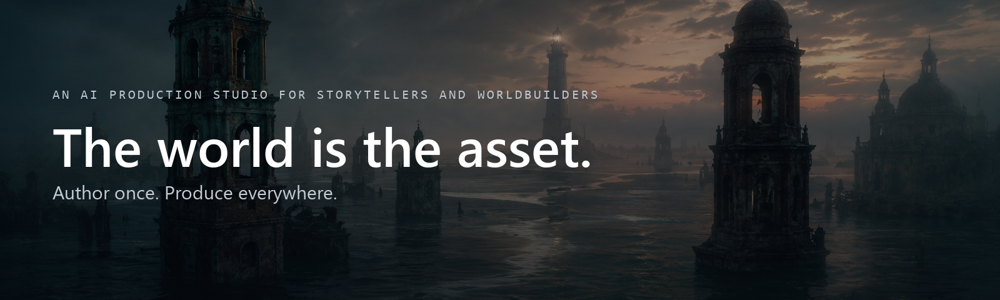

Build your world once as a durable creative foundation. Every story, audiobook, film, episode
and interactive experience you make from it draws on the same source and stays consistent
because they share it.

[](https://github.com/michaeljosiah/ArkeStudio/actions/workflows/ci.yml)
[](https://github.com/michaeljosiah/ArkeStudio/releases/latest)
[](LICENSE)

**[Write](#write-in-a-room-that-knows-your-world) · [Talk](#one-chat-from-anywhere) · [Listen](#the-book-reads-itself-aloud) · [Mix](#audio-studio) · [Publish](#publish-a-private-edition) · [Film](#from-script-to-screen) · [Anywhere](#on-every-screen-you-use)**

</div>

---

## What's new

- **A writing room that knows your world.** The chapter editor is rebuilt around the page.
  Names in the prose link to the cast, `@` and `/` reach the world and Arke from the caret, and
  Arke's edits wait in the text itself to be kept or refused. [See it →](#write-in-a-room-that-knows-your-world)
- **Audio Studio.** A chapter's narration, character voices, effects, ambience and music,
  arranged together on a 48 kHz stereo timeline whose cues follow the story. [See it →](#audio-studio)
- **One Chat, from anywhere.** Arke opens from the title bar of every screen, keeps its subject
  while you move, and takes pictures, files and your voice. [See it →](#one-chat-from-anywhere)
- **Private editions.** A story compiles into an EPUB to read and an M4B audiobook in Arke's
  narration and your cast's voices, checked for formatting and style first. [See it →](#publish-a-private-edition)
- **Atmosphere for film.** Particle effects that can react to the soundtrack, Air Particles
  with physics, blend modes and crossfades, with every Arke suggestion reviewed before it
  lands. [See it →](#atmosphere-crossfades-and-particles)
- **Your phone.** Pair it once and the writing room, the player, Audio Studio and Chat all
  fit the screen in your hand. [See it →](#on-every-screen-you-use)

## The idea

Most creative tools are organised around *projects*. You make a short film, and when it's
finished the film is the artefact. The world it was set in exists only in your head and
across a folder of notes.

Arke Studio inverts that. **Your world is the foundation.** Productions — novels, audiobooks,
films, episodes, interactive experiences — are what you develop from it, and a change to a
character lands in all of them.

That inversion is the whole product. Because the world is a real, versioned record rather
than a folder of documents, it can be *consulted*: asked whether something contradicts
what's already true, told what changes when a character does, and cited automatically by
everything it produces.

<div align="center">
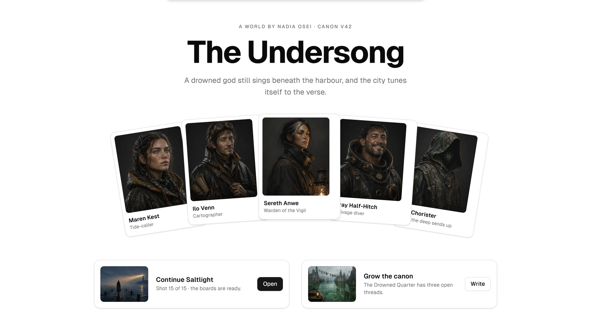

*One world, on your disk, at a version. The cast, the canon and the doors back into
whatever you were making from it.*
</div>

## Three mechanics

Everything else is surface.

**1. Authored facts enter through an accept.** Sheet edits, canon entries and scene drafts
arrive as *proposals*. Each is checked against canon, each shows what it would ripple into,
and each waits. Generated takes and operational records land as work happens; acceptance
controls what the authored work cites and uses.

**2. Canon refuses rather than guesses.** The world answers only from what is written, with
a citation per claim. Asked something it cannot support, it says so, cites the closest
entries it has, and offers to open a thread. It never invents behind your back.

**3. Identity travels.** A character is a main photo and one composite sheet. Those two
images follow them into every frame, on every provider that accepts references, so
consistency is structural rather than a function of prompt luck.

## Core concepts

| | |
|---|---|
| **World** | The asset. Holds the cast, the places, the factions, the canon, the tone and the look. |
| **Canon** | What is true. Versioned, typed (rule, lore, timeline, faction, tone), and answerable, including "the canon doesn't know, and won't guess." |
| **Art direction** | The world's visual language: a master look, a style description, a version. Every image inherits it; every exception says where it came from. |
| **Sheet** | A character, location or faction. Versioned, with a voice and an identity kit of two images. Sketch until you lock it. |
| **Production** | A story, film, album or game drawn from the world. Shares the cast and canon by reference. Nothing is copied, nothing is forked. |
| **Chapter** | The unit of a story production, with four views: **Chapter**, its production home; **Manuscript**, the page you write on; **Audiobook**, who reads what; and **Audio Studio**, the mix. |
| **Scene → Shot → Take** | The unit of work is the shot. Each is its own brief and its own retry. Accepted takes assemble the cut. |
| **Stage** | A shot's camera and blocking, worked out in 3D before you spend on a generation: cast and set placed once per scene, camera keys per shot. |
| **Artifact** | Recordings, documents, references. Filed by provenance, so anything that cited a sheet lands against it automatically. |
| **Publication** | A finished edition — a video, or a book with its audiobook — compiled out of the world into files that play and read without it. |

## How it works

Every authoring surface in Arke Studio follows one loop:

```
   talk it through  ──▶  a proposal  ──▶  checked against canon  ──▶  accept or discard
                                              │
                                              └── what else this changes, before you decide
```

You describe what you want in your own words. Arke drafts it, tells you what it checked and
what it would ripple into (*"14 reference images predate this change; scene 4's brief
re-renders its cast block; 3 productions pick it up on their next dispatch"*), and then waits.

**AI-authored changes wait for acceptance.** Jobs, reviews and generated takes exist as
operational records; the gate controls what proposed work becomes committed. Authors can
also save their own chapter edits directly.

## Write in a room that knows your world

A story production is a book, and every chapter opens on its manuscript: the page and nothing
else. One slim bar above it holds the chapter's views, its word goal, Focus and Compare. The
chapter's number and title are the top of the document, not a form above it.

<div align="center">

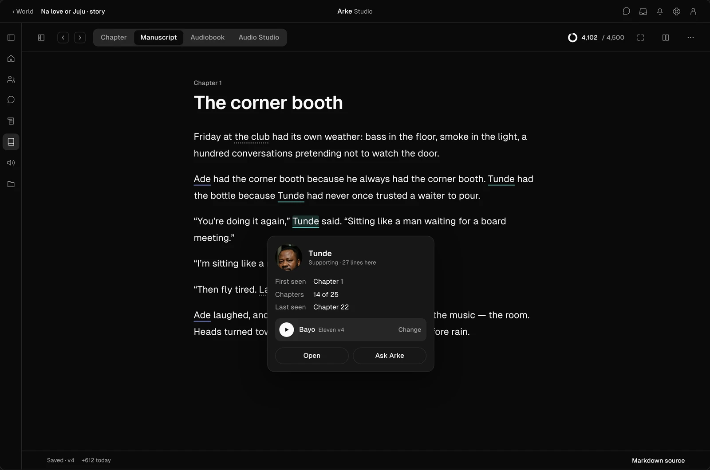

*The editor knows who it is writing about. Every person and place from the world is
recognised in the prose; hover a name for their face, their voice and where else they appear.
The underline is decoration only — the manuscript stays plain Markdown.*

</div>

Arke works in the page with you rather than in a chat window beside it. Everything it writes
arrives the same way: in place, marked as its own, and yours to keep or refuse.

<table>
<tr>
<td width="50%" valign="top">
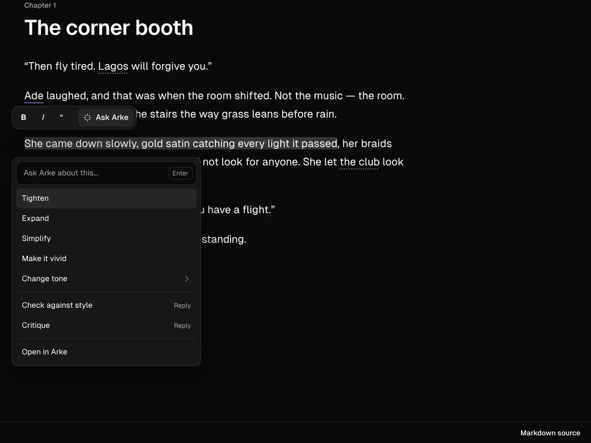
<br><b>Ask Arke about any selection.</b> Tighten, expand, simplify, make it vivid or change
its tone — or type your own ask. Critique and style checks reply rather than edit.
</td>
<td width="50%" valign="top">
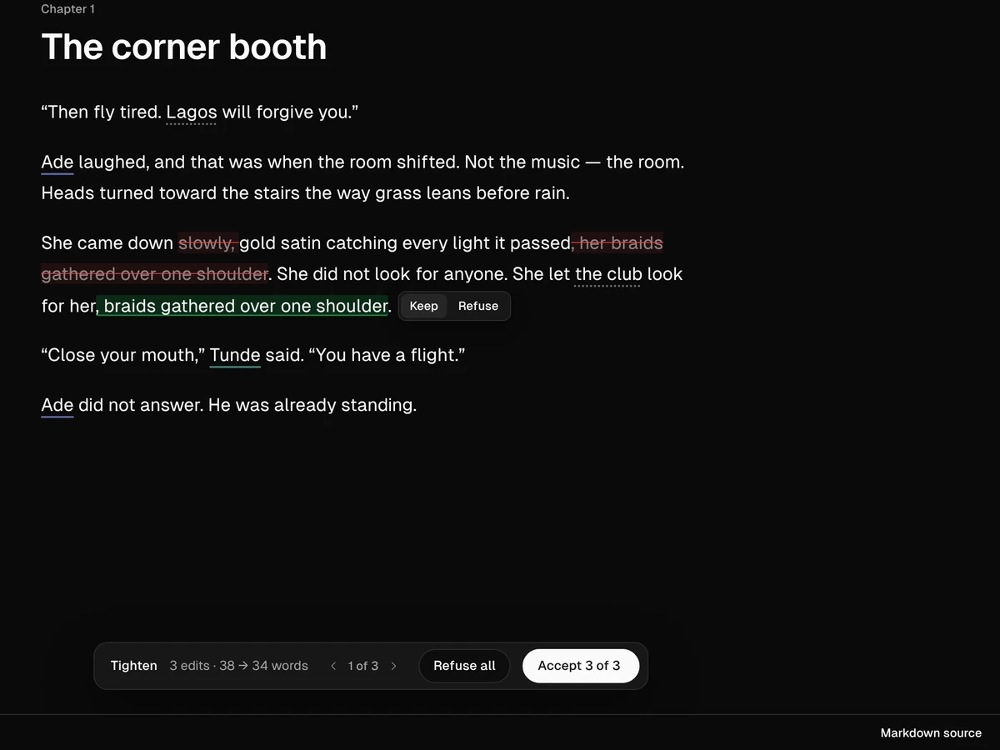
<br><b>Edits wait in the prose.</b> Each change is struck through and written in, kept or
refused one at a time. Ask again for up to three versions, then accept the ones you want.
</td>
</tr>
<tr>
<td width="50%" valign="top">
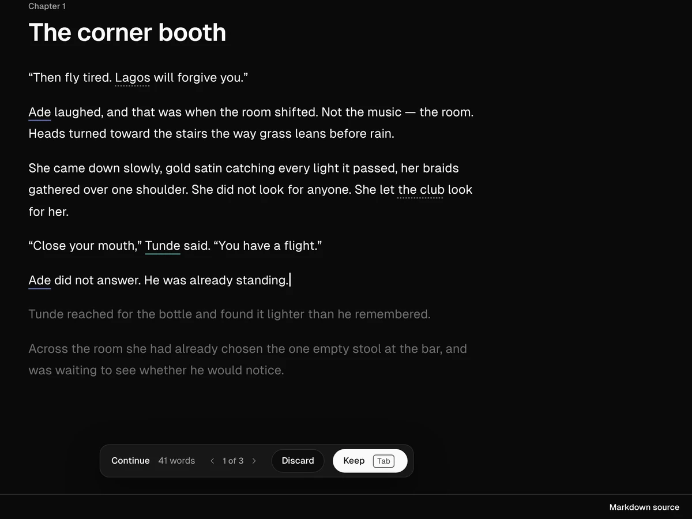
<br><b>Continue from the caret.</b> Arke's next lines appear in grey after your cursor.
<kbd>Tab</kbd> keeps them; anything else and they are gone.
</td>
<td width="50%" valign="top">
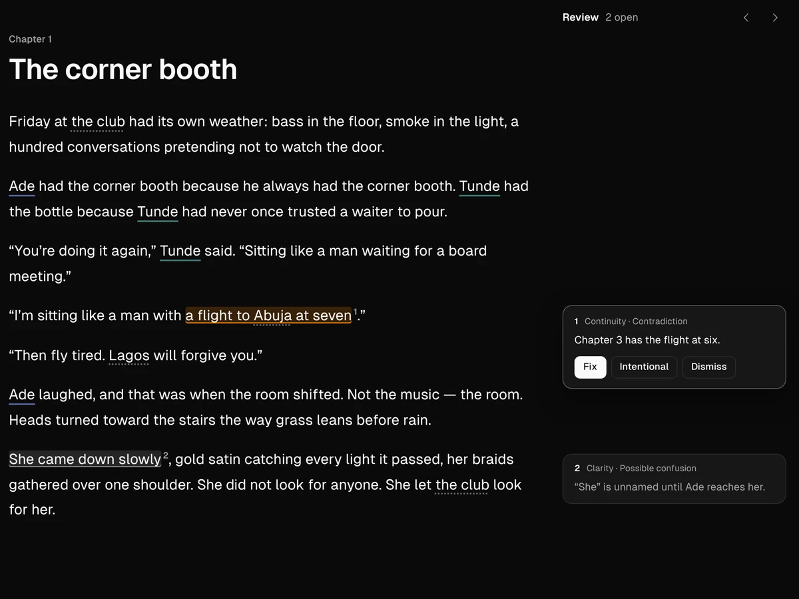
<br><b>Review notes beside the words they quote.</b> The chapter review checks continuity and
clarity against the rest of the book. Fix it, mark it intentional, or dismiss it.
</td>
</tr>
<tr>
<td width="50%" valign="top">
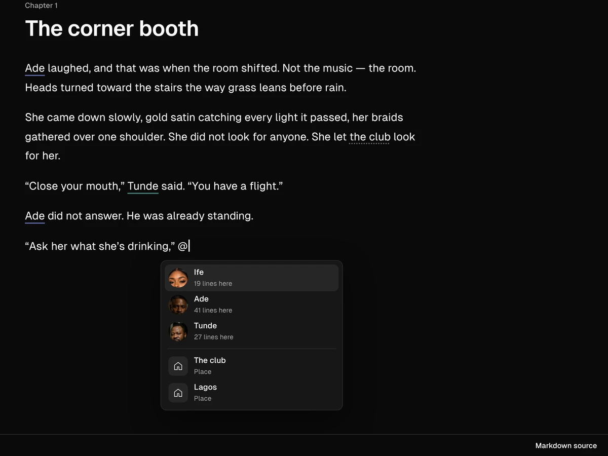
<br><b><code>@</code> brings in the world.</b> This chapter's people first, then the whole
cast, then places — each with their face and how much they speak here.
</td>
<td width="50%" valign="top">
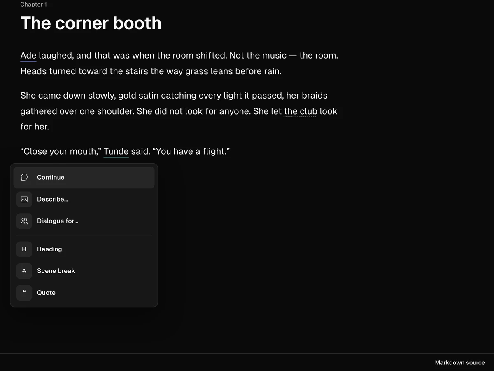
<br><b><code>/</code> puts Arke first.</b> Continue, Describe… and Dialogue for… sit above the
formatting commands, so the next line is always one keystroke away.
</td>
</tr>
</table>

Beyond those: **Compare** shows two versions side by side with Restore. **Focus** makes the
window the page, lights the paragraph you're in and dims the rest. A **new chapter** starts
from a short brief — synopsis, point of view, when it happens, its word goal — and Arke can
draft from it, draft the opening, or plan the beats. Bring an existing book in as a `.docx`
— Arke says which chapters it found before anything is written — and take it out again as
`.docx` or EPUB.

<div align="center">

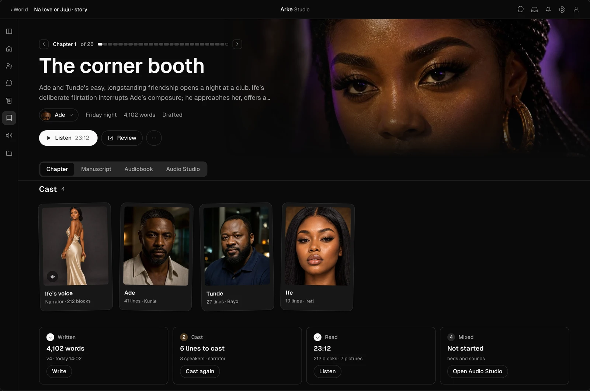

*Step back from the page to the **Chapter** view: the chapter's picture, its cast and their
voices, and how far it has come — written, cast, read and mixed — with the next step for each
one a press away.*

</div>

## One Chat, from anywhere

Arke opens from the same mark in the title bar of every screen. It knows what you're looking
at — the world, a production, a shot, a chapter — and the conversation stays put while you
move around, so you can check a frame or a character sheet without losing the thread.

<div align="center">

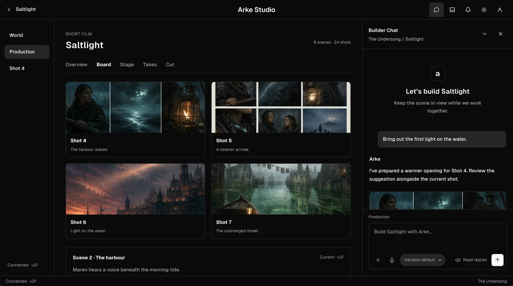

*Builder Chat beside a film's storyboard. Arke's answer is a proposal to review, not a change
already made.*

</div>

Attach a picture or a file, dictate instead of typing — transcribed on your machine and left
as a draft until you send it — and turn on **Read replies** to hear the answers aloud. The
model chip searches every provider you've connected, shows what each model can do and costs,
and keeps the effort setting beside it.

## The book reads itself aloud

Read a chapter or the whole book: the narration in the narrator's voice and each character in
their own, priced once before anything is spent.

<div align="center">

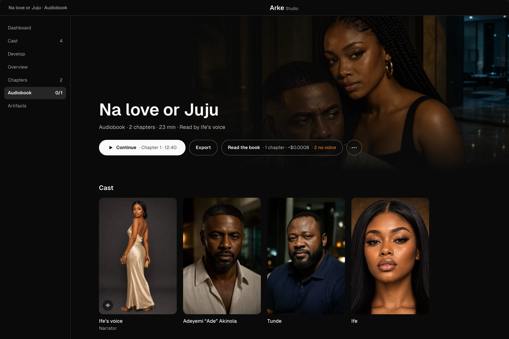

*The audiobook page is a show page: the cover as a backdrop, Continue first, the whole book's
price on one press, and the cast as portraits — the chapters follow beneath as episodes.*

</div>

How a narrator should play a character is written once, on that character's Voice tab, and
every book that reads them inherits it. A director pass groups a chapter into natural beats
instead of a block per paragraph, and a speaker you set on a line by hand always wins over
the one Arke worked out. A long read keeps running when you move to another world, and stays
in one row of the Activity panel while it does.

<div align="center">

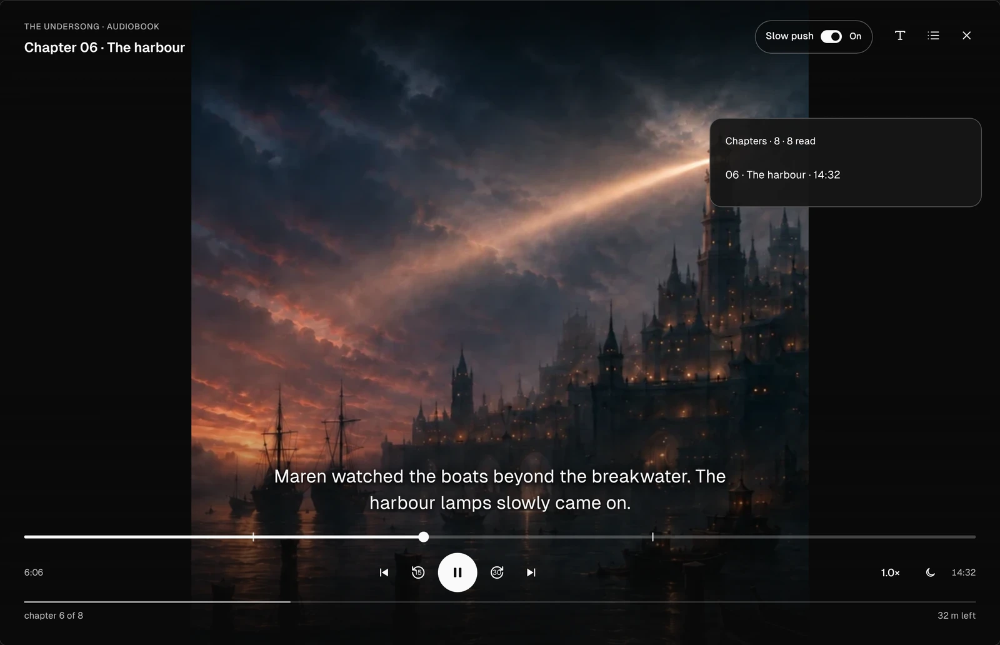

*Listen is a player, not a file list. The picture of the moment fills the screen with a
gentle slow push, and short captions follow the words as they're spoken.*

</div>

The same player exports as a package you can open anywhere, or renders to an MP4 — 16:9 or
9:16 — with the captions burned in.

## Audio Studio

A cast reading is the start of an audiobook, not the end of it. **Audio Studio** is where a
chapter becomes a mix: the narrator and each character on their own track, effects, ambience
and music beside them, and the script in the middle of the screen so you always know which
line you're hearing.

<div align="center">

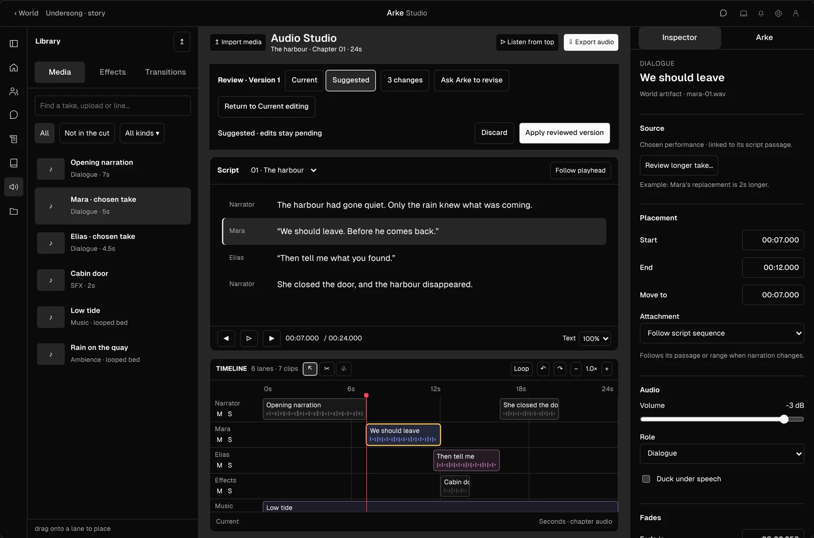

*Select a line and its performance lights up on the timeline; select a clip and its line
lights up in the script. Mara's longer take is waiting as a Suggested version, its three
changes counted before anything moves.*

</div>

**Cues follow the story.** A clip is placed by a rule as well as a time. It follows a passage
— the door closes at the end of Mara's line — spans a range, like harbour rain from arrival to
departure, or stays fixed where you put it. When a take gets longer, linked cues move with it
and fixed ones don't.

**Replacements are reviewed, never swapped underneath you.** A new take opens Current and
Suggested on one clock: what moves, what stays, which trims need another look. Apply is one
undoable step. Keep Current changes nothing.

**A real mixing surface.** Trim, split, crossfade, loop beds, duck music under speech, set
levels, mute and solo, and bring in your own recordings. The arrangement is 48 kHz stereo at
exact sample positions with twenty steps of undo that survive closing the app, and the one
mix it produces is what Listen, video exports and publication all play.

**Arke can propose an arrangement** — overlaps, reactions, beds — and it arrives as a
Suggested version you compare and apply yourself. Releasing a protected clip or leaving a
passage out of the mix are decisions only you can make.

## Publish a private edition

When the book is ready, **Publish** compiles it into an edition: an EPUB to read and an M4B
audiobook in Arke's narration and your cast's voices, under one title and one cover.

<table>
<tr>
<td width="50%" valign="top">
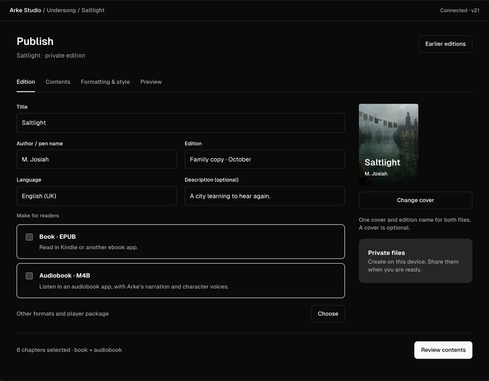
<br><b>One edition, read and heard.</b> Choose the chapters, the cover and the formats.
A formatting and style review runs first, and an approved fix flags the narration it affects.
</td>
<td width="50%" valign="top">
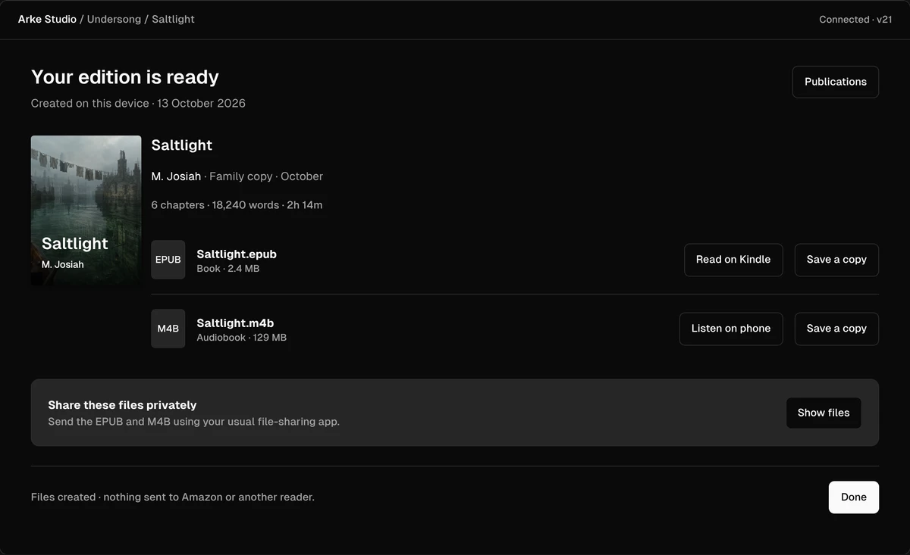
<br><b>Files you own.</b> Open the EPUB in Kindle or another reader and the M4B in an
audiobook app. Nothing is sent anywhere unless you send it.
</td>
</tr>
</table>

A film publishes the same way: the cut compiles into a portable video publication — the
picture, selectable caption tracks and a manifest that verifies every file — delivered as a
folder or a ZIP. Every edition outlives the working copy it was made from, and plays from
**Publications** without the world.

## From script to screen

In a video production the same loop carries a scene from a written beat to a finished cut, and
every stage of it is a screen you actually work in — not a black box between "generate" and "done."

<div align="center">

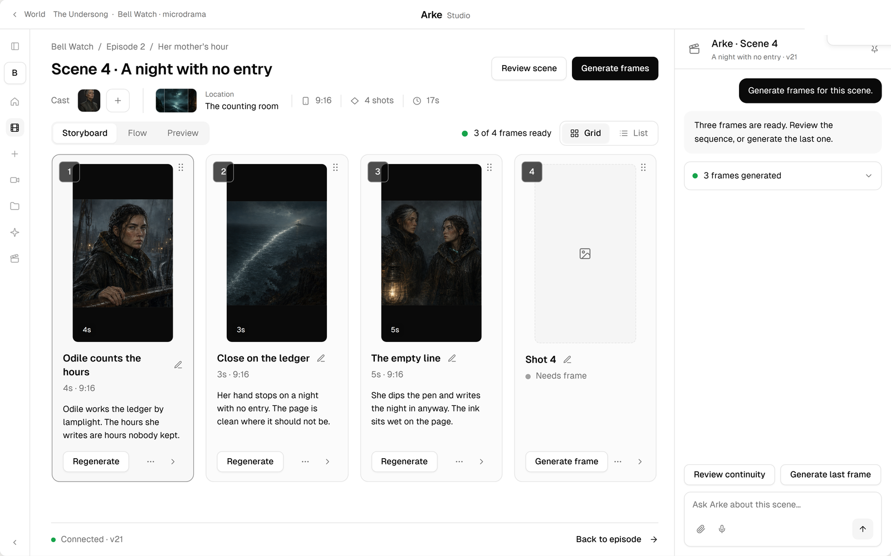

**The storyboard writes the shot list with you.** Each shot is its own brief, its own
frame and its own retry. Arke reads the scene and tells you what's still missing — here,
one frame out of four.

<br>

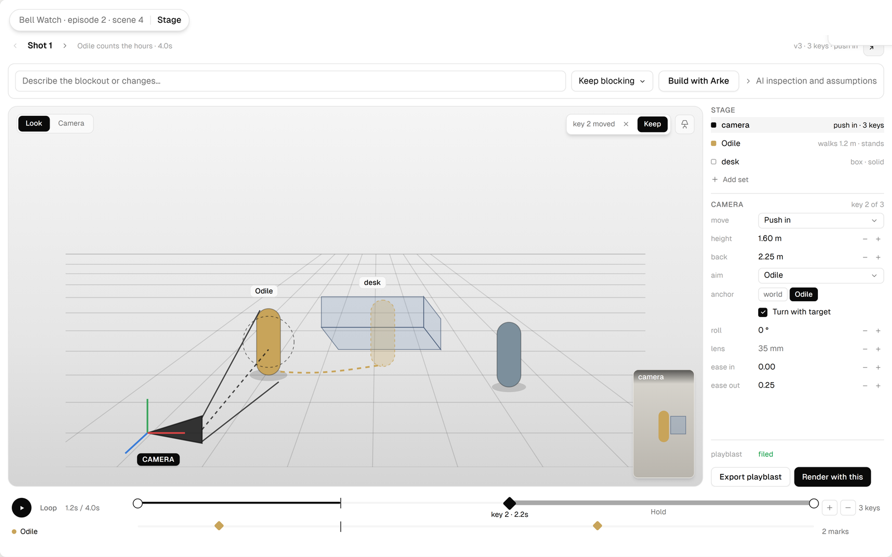

**The Stage blocks the shot before you spend on it.** Cast and set are placed once per
scene; the camera is keyed per shot — height, distance, lens, easing — and previewed as a
playblast. Describe a change in a sentence and Arke rebuilds the camera around it — the
blocking stays put unless you ask it to revise that too — or move the keys yourself.

<br>

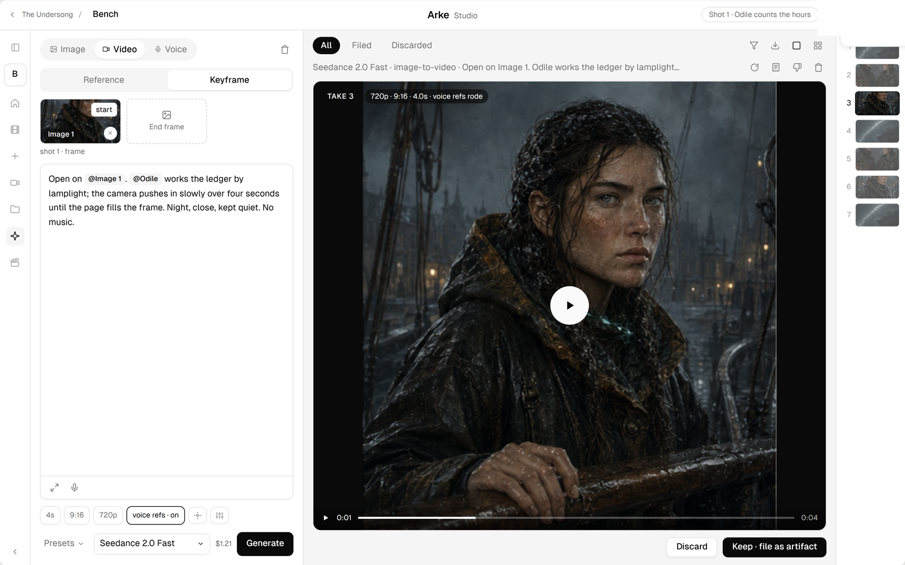

**The Bench dispatches with everything attached.** A keyframe, a written prompt, voice
references, the model and its price, all in one row. Every take is kept until you discard
it, so a regenerate is never a gamble on losing what you had.

<br>

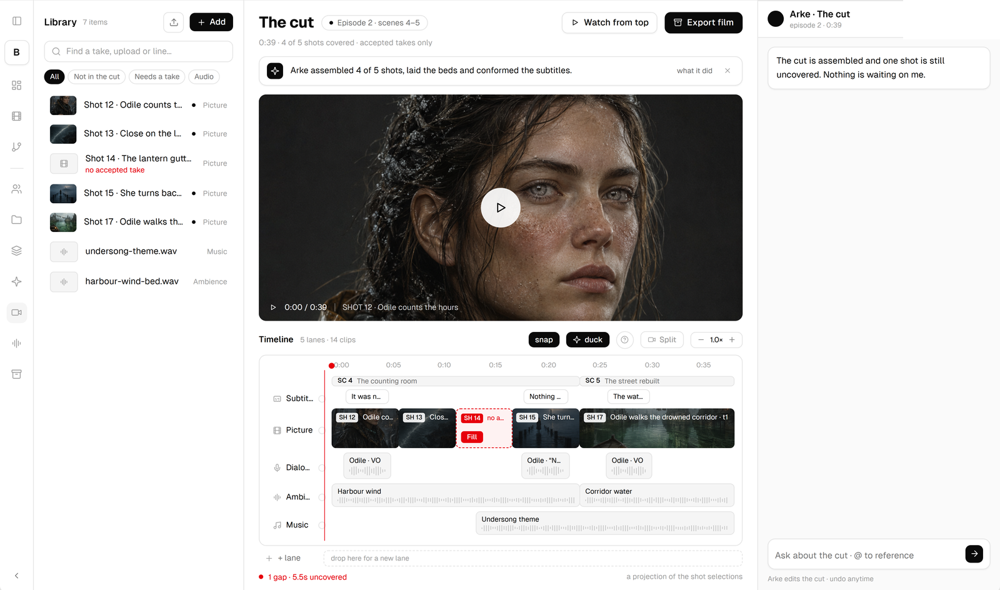

**The cut assembles itself from what you've accepted.** One pass places every shot's
picture in script order, conforms the subtitles, and lays an ambience bed under the
scene; dialogue and music are lanes in the same timeline, worked in the same way. Gaps
are called out by name rather than left silent.

<br>

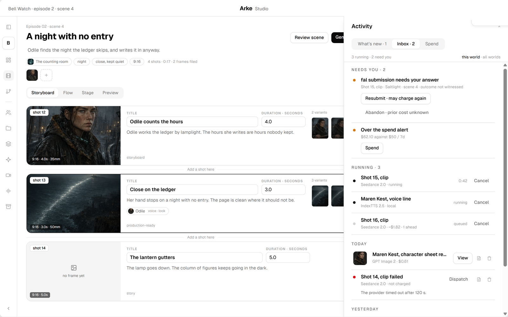

**Nothing runs unwatched.** Every dispatch and every voice line lands in one panel — what
needs your answer, what's running right now with Cancel on every job still stoppable, and
what a failure actually said before you retry it. Spend is tracked against a threshold you
set, and every receipt keeps its estimate's own tilde — nothing is claimed as measured until a
provider actually reports what it charged.

</div>

### Atmosphere, crossfades and particles

The cut is also where a film gets its air. Effects are layers with their own placement and
timing, so atmosphere can sit over a single shot or the whole film.

<table>
<tr>
<td width="50%" valign="top">
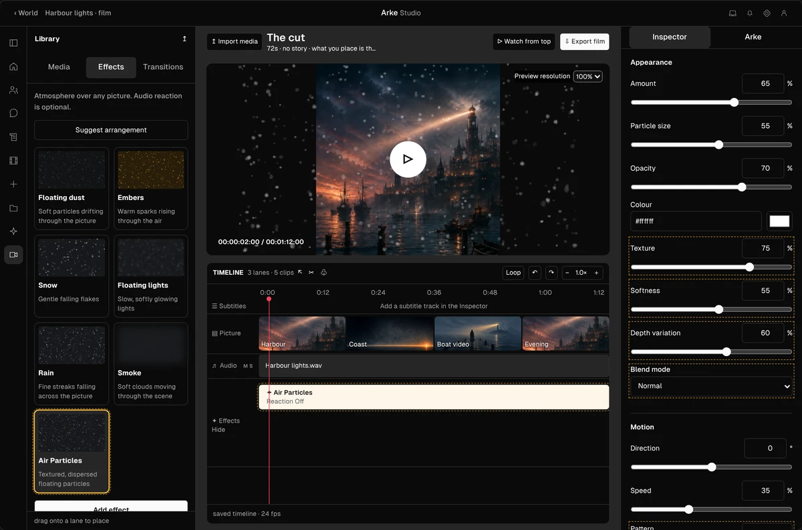
<br><b>Atmosphere you can shape.</b> Floating dust, embers, snow, floating lights, rain,
smoke and Air Particles with real physics. Each one can react to the soundtrack's beat, bass
and energy, or ignore it.
</td>
<td width="50%" valign="top">
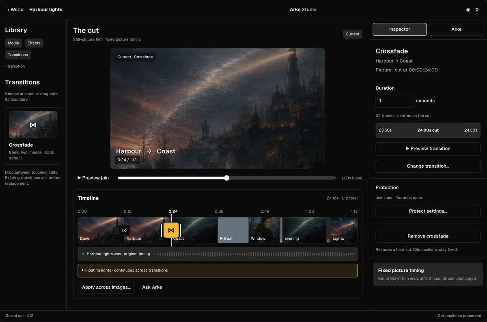
<br><b>Crossfades at fixed cuts.</b> Hover a join and add a transition, drag its handles or type
its frames, or apply one across every image in a range. The picture timing never shifts.
</td>
</tr>
</table>

Blend modes let an imported overlay add light rather than cover the picture. Arke can suggest
a whole arrangement of effects or transitions, which you review in Current and Suggested,
adjust with the ordinary controls and apply as one undoable change — and any setting you
protect is one its suggestions leave alone.

## On every screen you use

Arke Studio runs on your PC, and your phone reaches it. Turn on **Settings → Remote access**
in the desktop app and pair a phone once: the writing room, the player, Audio Studio and Chat
are all drawn for a phone and for a folding screen, not just squeezed onto one.

<div align="center">

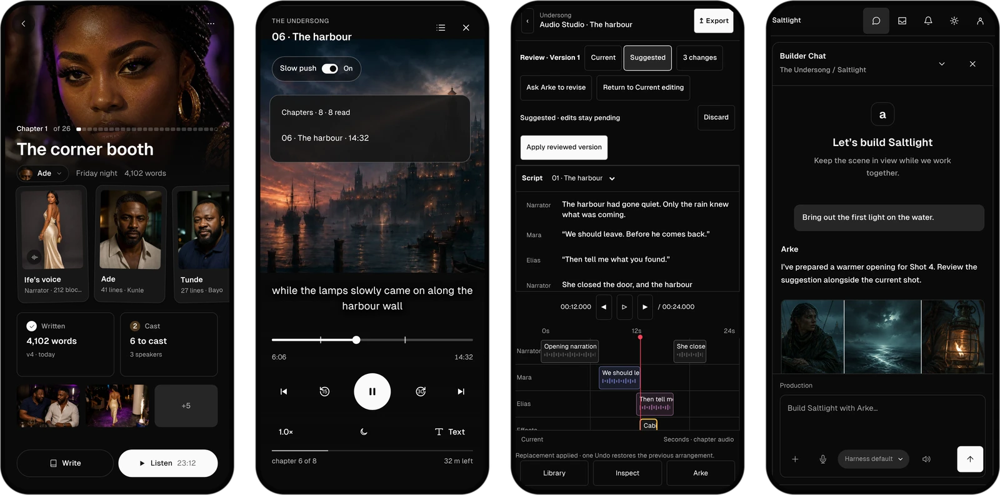

*A chapter, the player, Audio Studio and Chat on a phone. Your worlds never leave your PC;
the phone is a window onto it.*

</div>

## What you can make

One world, many productions, all starring the same characters in the same places under the
same rules:

- **Story** · novels, novellas, short fiction, screenplays and audio-first scripts, written
  chapter by chapter with the canon as editor, imported from and exported to `.docx` and EPUB,
  read aloud as a cast audiobook, mixed in Audio Studio, and published as an EPUB and M4B edition
- **Video** · *Microdrama* (short-form episodic drama), films, music videos, and interactive
  branching narratives with a drawn branch map and their own player, with boards and shots
  dispatched to video models with references attached
- **Visual novel** · an interactive story told in pictures, text and voices, authored as beats
- **Adaptations** · start a micro drama or a film *from* a story in the same world, with Arke
  working from the book's chapters and beats rather than a summary of them

Visual assets — concept art, character references, storyboards and promotional material — travel
with every production as they develop.

A change to a character lands in all of them.

## Coming next: Audio Drama

Audio Studio is also the start of something larger. **Audio Drama** — a production written for
the ear, adapted from a story in the world or started from an idea — is drawn in the design
master as a proposal awaiting review. It is not built, and these screens are a design, not
the app.

<table>
<tr>
<td width="50%" valign="top">
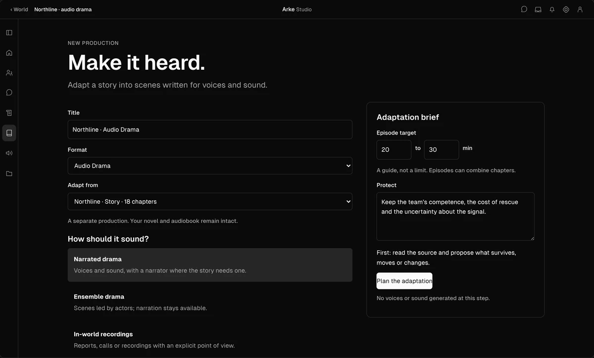
<br><b>Adapt a story for the ear.</b> Choose the source, an episode length and how it should
sound — narrated, ensemble or in-world recordings — and plan the adaptation before a single
voice is spent.
</td>
<td width="50%" valign="top">
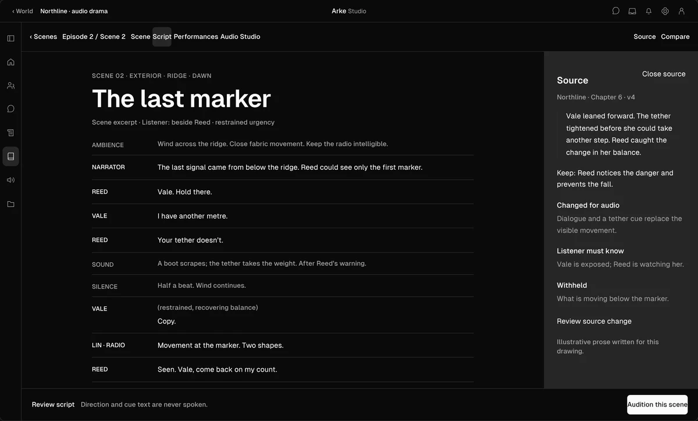
<br><b>A script that can be performed.</b> Narration, dialogue, sound, ambience and silence as
cues in the writing room, with the source passage beside every scene and nothing about the
novel rewritten.
</td>
</tr>
</table>

## Models, voices and harnesses

Arke does not assume one provider. Settings chooses the default models; a world can choose its
own, and a production its own again, each inheriting whatever it leaves unset.

- **Harness** · the agent that does the writing. Claude Code, OpenCode and Codex are all
  selectable, with per-agent model overrides, and Arke carries a harness of its own that runs
  against Ollama on your machine. With no harness chosen and no cloud key stored, it runs locally
  rather than refusing.
- **Text** · local models through Ollama, among them Gemma 4 12B, or your own cloud accounts.
- **Images** · cloud image and video models with references attached, or local recipes run on
  your own graphics card through a managed ComfyUI: Krea 2, and Qwen Image 2.1 as a research
  recipe whose licence allows noncommercial use only.
- **Voice** · Kokoro on your machine, or Google's Gemini voices, ElevenLabs, Mistral's Voxtral,
  BreezeBlue's Breeze TTS 2 and Fish Audio's S2.1-Pro as hosted readers. A voice can be designed
  from a character's sheet. A read longer than a reader's limit is split at sentence ends and
  plays as the pieces arrive.

## Get it

Currently unsigned Windows installers are on the [releases page](https://github.com/michaeljosiah/ArkeStudio/releases/latest).
Windows 11, x64 and ARM64. Free.

First run downloads the local runtimes it needs (Ollama for local text, Kokoro for speech,
Whisper for dictation). Cloud providers are optional and you supply your own keys.

## Principles

**Your world remains yours.** Arke Studio runs on your machine. Worlds live on your disk in
a readable, portable format. Nothing leaves except the generations you explicitly approve.
An account is never required to open, create or continue a world.

**You decide what becomes true.** Arke can propose boldly, but it cannot quietly rewrite
accepted work. Material changes remain visible proposals, shown with what they would disturb,
until you approve them — in the prose, on the timeline and in the mix alike.

**Canon that distinguishes fact from invention.** The world answers from what is written, with
a citation per claim. Asked something it cannot support, it says so, cites the closest entries
it has, and offers to open a thread. It never invents behind your back.

**Choose how and where intelligence runs.** Use local models, bring your own provider accounts,
or choose managed access. Costs remain visible in real currency before anything is spent, tracked
against a threshold you set, and a running job can be cancelled — right up until its result is
already in — from the same panel that watches it. The managed route is a convenience, never the
only easy path.

## How this is built

Arke separates the reusable engine, the Studio application and the host that runs it.
The same Studio server can run inside Electron or as a standalone Node process, with the
React frontend connecting through authenticated WebSocket and media endpoints.

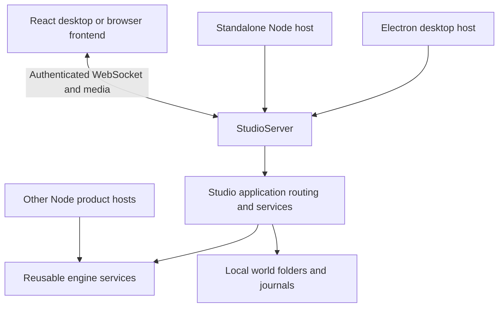

The **engine** exposes a supported Node API for world reads, proposals, portrait generation
and prose authoring, including AI drafting, revision and committed-manuscript output, and a
chapter's page illustration and narration.
It does not start a server. A product host supplies its permissions, persistence and generation
integrations. See [engine services and host contracts](docs/development/engine.md).

The **Studio application** adds Studio's workflows and command routing. Responsibilities are
being extracted into focused services; the Coordinator still orchestrates features that have
not moved yet. **StudioServer** owns transport authentication, listening and connection
shutdown. Desktop supplies native integrations; the standalone Node host supplies local
filesystem persistence. Both use the same application services and lifecycle.

This makes the engine reusable by other products without requiring them to call Studio's
server. The supplied Studio hosts still store worlds in local folders; cloud persistence and
Aonik integration are separate work.

For a first code-reading session, start with [AGENTS.md](AGENTS.md) and the
[developer index](docs/development/README.md): package relationships, workflow traces,
test selection and generated-file ownership.

Arke is specified before it is written. A behaviour is decided in a capability spec — with its
requirements, its design reasoning and its decision log — and only then built. The screens are
drawn the same way, in a versioned design master
([`design-system/Arke Studio.dc.html`](design-system/Arke%20Studio.dc.html)), before a line of
the screen's own code exists. The screenshots in this README are rendered from that master: the
approved drawings the app is built against. The running app follows them closely but not pixel
for pixel, and the Audio Drama screens are a proposal that has not been built.

The specification set is not published with the code. It is the design record rather than the
product, and it stays private. That is worth knowing before you read far, because the code cites
it constantly: `SPEC-014 §3` in a comment or a test name is a real reference to a real document,
just not one in this repository. Read those as markers of where a decision was made, not as
dead links.

Two references are read off the source rather than off the specs, and both are here.
[`docs/architecture/`](docs/architecture/index.html) is an illustrated guide to how Arke is built —
the files on disk, the model behind worlds and productions, the accept gate, generation and spend,
and the program itself — written to be readable without a background in code. It explains the
product that exists, which is why it stays public while the specs do not.
[`docs/filesystem-operations.md`](docs/filesystem-operations.md) is the exact list of what each
operation creates, replaces, appends, moves or removes.

| | |
|---|---|
| `packages/contracts` | Zod schemas and the pure judgements the client and coordinator share |
| `packages/engine` | Supported embeddable Node API and optional local adapters |
| `packages/coordinator` | Application services, Studio routing, local persistence, jobs, spend and server host |
| `packages/client` | The React desktop and browser frontend |
| `packages/adapter-opencode` | The writing harness |
| `packages/adapter-claude` | The bring-your-own harness, over the Claude Agent SDK |
| `packages/adapter-codex` | The Codex writing harness |
| `packages/confined-tools` | File and world-query tools confined to a session's folder, shared by harnesses that run tools themselves |
| `packages/providers` | Provider clients and the model manifest |
| `packages/voice` | The Voxa sidecar client |
| `apps/desktop` | The Electron shell that embeds the Studio host and supplies native integrations |
| `design-system` | The design master, the prototype, the design template and proposal pages |

## Run from source

Install Node 22.12 or newer, then run `npm ci` from the repository root.
For the desktop app, run `npm start`.

For everyday phone access, enable **Settings → Remote access** in the desktop app and pair the
phone once. Its clean HTTPS address can be bookmarked; optional startup at sign-in keeps the
host available in the background. See [Opening Studio from another device](docs/development/remote-access.md).

To run Studio without Electron for development, start the server in one terminal:

```powershell
npm run server -- --root C:\ArkeData
```

In a second terminal, run `npm run dev` and open the private **Arke session** link it prints.
The server uses the supplied local data root; the frontend runs separately. This initial
host serves one session over loopback. To open it from a phone or another computer, see
[Opening Studio from another device](docs/development/remote-access.md), which uses Tailscale
Serve and keeps the server on loopback. Provider-key storage needs a host-supplied
secure cipher, and native tools need their platform adapters. See the
[standalone server guide](docs/development/standalone-server.md) for configuration and limits.

## Status

**The core loop is built, end to end.** Worlds as folders you own, canon with verified
quotations and typed refusals, proposals staged with ripple computation, reference sets that
travel into every dispatch, real currency shown before spend with running jobs cancellable
from the Activity panel, a shot page carrying its frame, its camera and its 3D Stage together,
and a cut that assembles itself from accepted takes.

**Story mode is built through to a published edition.** The chapter writing room with linked
names, Ask Arke, Continue, versions, Compare, Focus and margin review notes; `.docx` import;
a cast audiobook read by a narrator and the characters' own voices; Audio Studio for the
chapter mix; and private EPUB and M4B editions.

**The cut has effects and transitions.** Atmosphere presets with optional audio reaction, Air
Particles with physics, blend modes and crossfades at fixed cuts, each with Arke suggestions
reviewed before they apply.

**Video publications compile and play.** A cut becomes a portable, verified edition with
selectable captions, delivered as a folder or ZIP and played from Publications. Interactive
video is not yet a publication profile.

**The reusable engine and standalone Node host are available from source.** Desktop and browser
hosts share Studio's application services; the public engine exposes a bounded set of those
capabilities for other Node products.

**Audio Drama is a design proposal.** It is drawn in the design master for review and is not
in the app.

**Cloud experience is named but not yet connected.** The launch screen already offers "Arke Studio
Cloud — access your worlds anywhere. Sync, collaborate, create" but integration with Aonik
(the platform foundation) is not yet complete.

**The audience journey is incomplete.** Episode creation and episode detail/chat screens have
implementation, but do not yet establish a complete season-production and audience-publishing
workflow. See the [implementation status notes](docs/development/status.md) for evidence and limits,
and the [Audio Studio notes](docs/development/audio-studio.md) for what that workspace does today.

This repository holds the code and the design system. The product's direction and requirements
live in the specification set, which is not published.

## Contributing

Bug reports, fixes and specification amendments are welcome — see
[CONTRIBUTING.md](CONTRIBUTING.md) for how changes are shaped and tested.

Every contributor signs the [Contributor Licence Agreement](CLA.md) before their first change is
merged. You keep the copyright in your work; the grant is broad enough that the project can ship
it under the AGPL and under commercial terms alongside it. That is how the work is funded, and it
is stated plainly rather than buried.

## Licence

AGPL-3.0-only. See [LICENSE](LICENSE).

You may use, modify and run it, including commercially. If you distribute it, or offer it to
others over a network, AGPL §13 requires you to make your source available to those users under
the same terms. Third-party components and their obligations are recorded in
[THIRD-PARTY-NOTICES.md](THIRD-PARTY-NOTICES.md).
